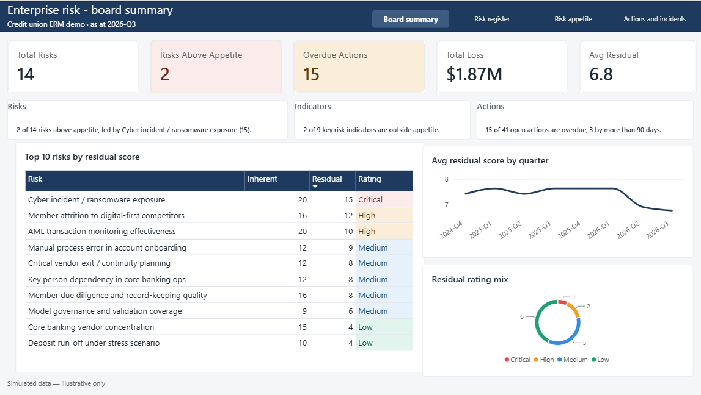
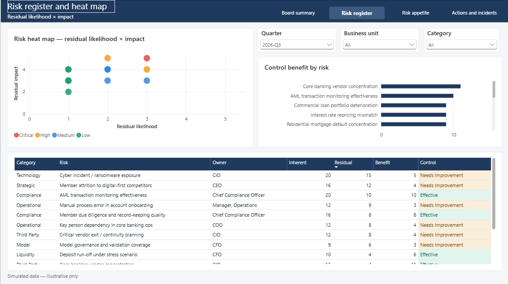
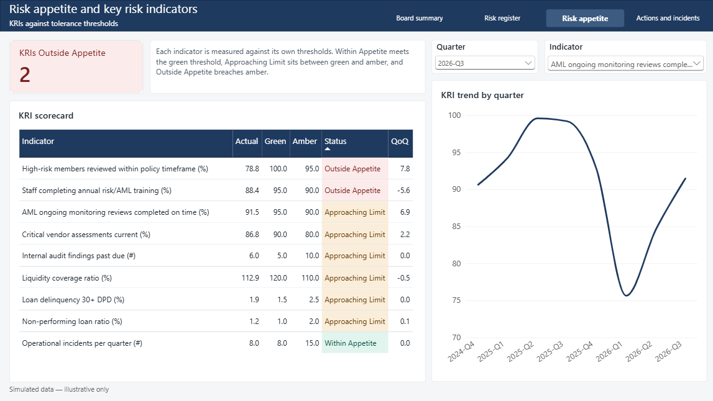
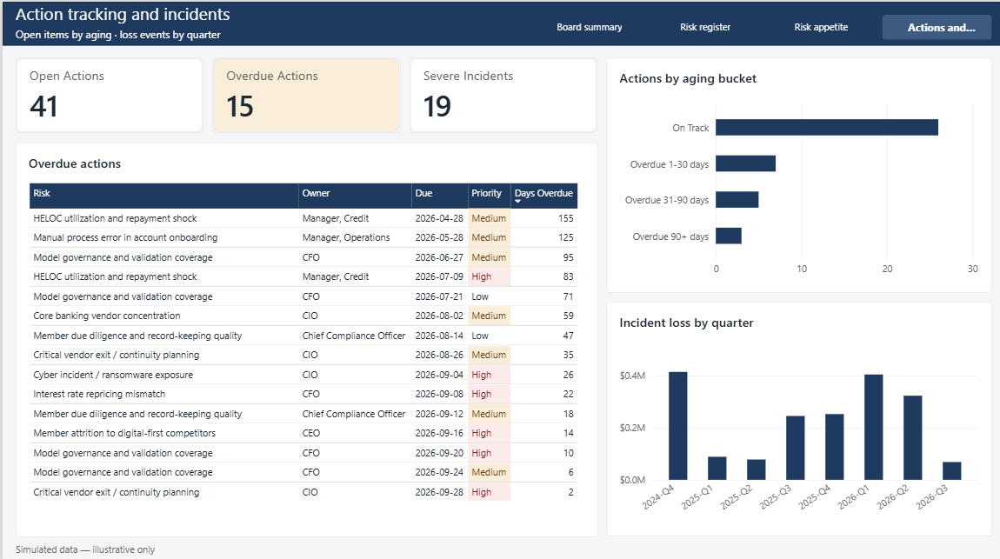
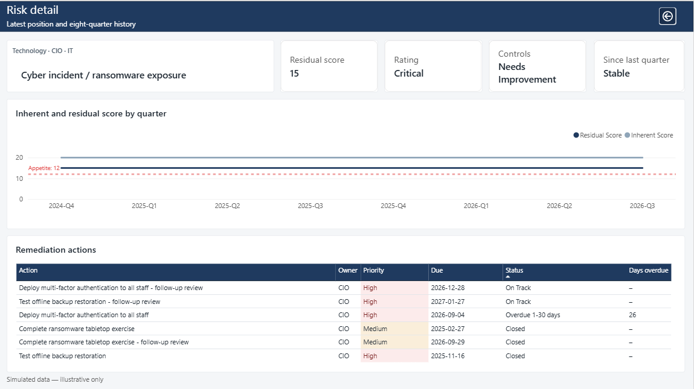
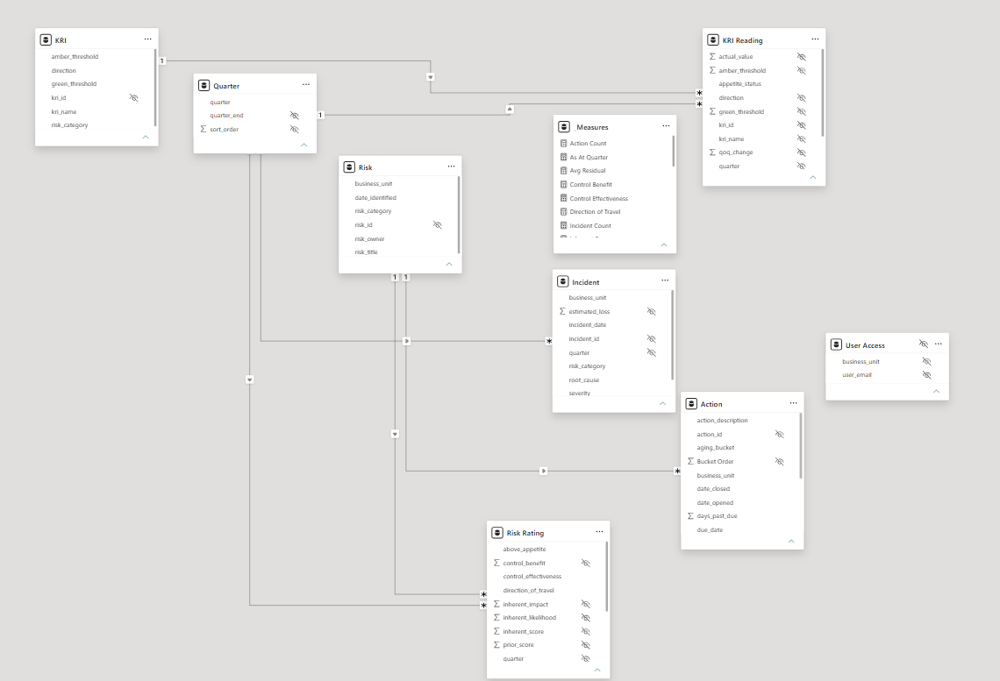

# Enterprise Risk Management Board Dashboard

A board-level enterprise risk management (ERM) report for a credit union, built in **PostgreSQL** and **Power BI**. It gives a CEO and board one view of the risk register, risk appetite, key risk indicators (KRIs), remediation actions and loss events, with the history behind each number.

> **Simulated data.** Every risk, indicator, action, incident and user in this project is invented for demonstration. No real organisation's data is used, and no real person is represented.

**[View the live report](https://app.powerbi.com/view?r=eyJrIjoiNDM5YTc0NmItYjdmYi00YzJlLTlkYTUtMzdiMTgzMzVjMTE4IiwidCI6IjM2YjZhNmM5LTQzYTAtNGY1Mi04NDVmLTAyMTc4NDU5OThjMCJ9)** · [PDF version](docs/ERM%20dashboard.pdf)



---

## What the report answers

| Page | Question it answers |
|---|---|
| **Board summary** | Where do we stand this quarter, and what should the board look at first? |
| **Risk register** | Which risks are largest after controls, and how well are the controls working? |
| **Risk appetite** | Which KRIs are inside, near or outside their tolerance, and how have they moved? |
| **Actions and incidents** | Is remediation on time, and where are losses occurring? |
| **Risk detail** (drill-through) | For one risk: its profile, eight-quarter score history and every remediation action |

All figures are as at **2026-Q3** (30 September 2026), with history from 2024-Q4.

## Features

- **Star schema** with three dimensions and four fact tables, one fact table per subject, no duplicated data.
- **Explicit DAX measures** for every number on the report, organised in display folders. No implicit "Sum of" fields.
- **Point-in-time logic.** Risk and KRI measures resolve the reporting quarter themselves, so a quarter slicer gives a true look-back on the risk register and KRI pages.
- **Fixed reporting date.** Action aging is calculated against a stored as-at date, not the current date, so the report gives the same answer whenever it is refreshed.
- **Configurable risk appetite.** The appetite threshold is stored as a setting in the database, not hard-coded in measures.
- **Narrative key messages** on the board summary, written by DAX measures so they update with the data and the viewer's permissions.
- **Drill-through** from any risk to a detail page, and a **report-page tooltip** on the heat map.
- **Dynamic row-level security** by business unit, driven by a user access table.
- **Reconciled figures.** Cards, charts and tables are built on shared measures, and every total has been checked against its breakdown.

## Screenshots

| Risk register | Risk appetite |
|---|---|
|  |  |

| Actions and incidents | Risk detail |
|---|---|
|  |  |

---

## Data model



| Table in Power BI | Source | Type | Grain |
|---|---|---|---|
| Risk | `dim_risk` | Dimension | One row per risk |
| KRI | `dim_kri` | Dimension | One row per key risk indicator |
| Quarter | `dim_quarter` | Dimension | One row per quarter |
| Risk Rating | `vw_risk_quarter` | Fact | One row per risk per quarter |
| KRI Reading | `vw_kri_status` | Fact | One row per KRI per quarter |
| Action | `vw_action_aging` | Fact | One row per remediation action, as at the reporting date |
| Incident | `fact_incident` | Fact | One row per loss event |
| User Access | `dim_user_access` | Security | One row per user per business unit (hidden, unrelated) |

All relationships are one-to-many with single-direction filtering. Business logic sits in SQL views, so the same rules apply to any tool that reads the database.

Full column definitions are in [docs/data-dictionary.md](docs/data-dictionary.md).

## Business rules

**Risk scoring.** Likelihood and impact are each scored 1 to 5. Inherent score is inherent likelihood × impact. Residual score is residual likelihood × impact, after controls. Control benefit is inherent minus residual.

| Residual score | Rating |
|---|---|
| 15 to 25 | Critical |
| 10 to 14 | High |
| 5 to 9 | Medium |
| 1 to 4 | Low |

**Risk appetite.** A risk is above appetite when its residual score is 12 or more. The threshold is stored in `report_config.risk_appetite_score`.

**KRI status.** Each indicator has a green and an amber threshold and a direction (whether higher or lower is better).

| Status | Rule |
|---|---|
| Within Appetite | Meets the green threshold |
| Approaching Limit | Between the green and amber thresholds |
| Outside Appetite | Beyond the amber threshold |

**Action aging.** Open actions are aged against the as-at date in `report_config.as_at_date`: On Track, Overdue 1-30 days, Overdue 31-90 days, Overdue 90+ days. Closed actions are reported separately.

**Direction of travel.** Each risk's residual score is compared with the previous quarter: Increasing, Decreasing, Stable, or New in its first quarter.

## Row-level security

The role **Business unit access** filters the Risk and Incident tables to the business units mapped to the signed-in user in `User Access`. Risk ratings and actions follow through their relationships. A user mapped to `All` sees every unit. KRIs are enterprise-level indicators and are visible to every user by design.

To test it in Power BI Desktop: Modeling → View as → tick **Other user** and **Business unit access**, then enter one of the example users:

| User | Sees |
|---|---|
| `cro@example.com` | All business units |
| `lending.manager@example.com` | Lending |
| `compliance.officer@example.com` | Compliance |

The emails use the reserved `example.com` domain and do not belong to anyone.

---

## How to run it

**Requirements:** PostgreSQL 15 or later with pgAdmin, and Power BI Desktop.

1. **Create the database.** In pgAdmin, create an empty database named `erm_demo`.
2. **Load the data.** Open the Query Tool on `erm_demo`, open `sql/erm_demo.sql`, and run it. It creates every table, view and setting, and loads the simulated data.
3. **Open the report.** Open `powerbi/ERM dashboard.pbix` in Power BI Desktop.
4. **Point it at your database.** Go to Transform data → Data source settings, select the PostgreSQL source, choose Change source, and enter your server name (usually `localhost`) and `erm_demo`.
5. **Refresh.** Click Home → Refresh.

To change the reporting date or the appetite threshold, update `report_config` and refresh:

```sql
UPDATE report_config SET as_at_date = '2026-09-30', risk_appetite_score = 12;
```

## Repository structure

```
erm-board-dashboard/
├── README.md
├── sql/
│   └── erm_demo.sql            Schema, views, settings and simulated data
├── powerbi/
│   └── ERM dashboard.pbix      Power BI report with row-level security
└── docs/
    ├── data-dictionary.md      Tables, columns and measures
    ├── ERM dashboard.pdf       Static export of the report
    └── screenshots/
```

## Scope and limitations

- **Simulated data at a small scale:** 14 risks, 9 KRIs and 60 actions over eight quarters. A production register would be larger, with risk hierarchies and many more owners.
- **No capital or stress-testing content.** ICAAP, capital planning and stress-test results are out of scope.
- **KRIs are not linked to individual risks.** They are reported at enterprise level by risk category.
- **Overlapping heat map points.** Where two risks share a likelihood and impact, their points overlap, and the tooltip shows the one on top.
- **Public link.** Power BI does not allow Publish to web for reports with row-level security, so the live report is a copy without the security role. The file in this repository includes it.

## Tools

PostgreSQL 17 · pgAdmin · Power BI Desktop · DAX · Power Query

---

Built by **Pranav Sonik**. [LinkedIn](https://www.linkedin.com/in/pranavsonik/)
